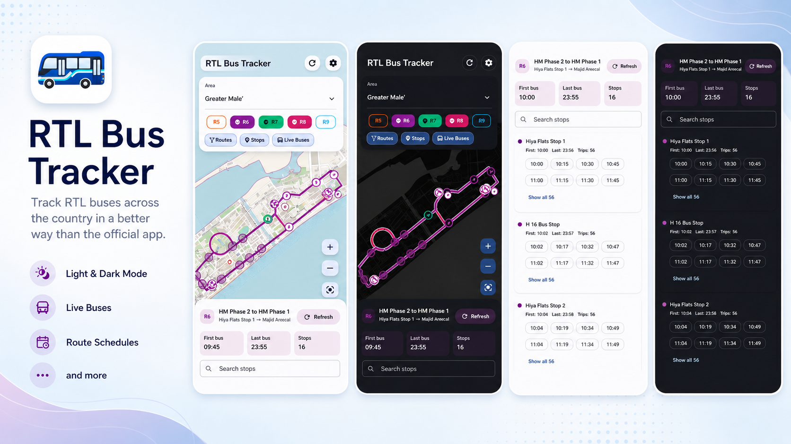

# RTL Bus Tracker

**Find your route. Follow your bus. Get alerted before it reaches your stop.**

An Android-first Flutter app for exploring RTL bus services in the Maldives, with live maps, arrival estimates, schedules, and distance-based alerts.

### [⬇ Download for Android](https://github.com/Farish278/rtl_bus_tracker/releases/latest/download/app-release.apk)

[Latest release](https://github.com/Farish278/rtl_bus_tracker/releases/latest) · [All releases](https://github.com/Farish278/rtl_bus_tracker/releases) · [MIT license](LICENSE)

---

[Download & install](#download--install) · [Features](#features) · [Getting started](#getting-started) · [Development](#development)

## Download & install

**[Download the latest Android APK](https://github.com/Farish278/rtl_bus_tracker/releases/latest/download/app-release.apk)** — download directly without searching through releases.

| Looking for… | Link |
| --- | --- |
| The app for Android | [Download APK](https://github.com/Farish278/rtl_bus_tracker/releases/latest/download/app-release.apk) |
| Latest release notes and files | [Latest release](https://github.com/Farish278/rtl_bus_tracker/releases/latest) |
| An older version | [All releases](https://github.com/Farish278/rtl_bus_tracker/releases) |

1. Open the APK download link on your Android device.
2. Open the downloaded `app-release.apk` file. If Android prompts you, allow your browser or file manager to **install unknown apps**, then continue installation.
3. Launch RTL Bus Tracker and choose your area and routes.
4. Allow notifications when setting up bus alerts. Allow location access to use **My location**.

The APK link follows the latest published release. If its APK is still building, wait for the release workflow to finish and try again. Android is the primary supported platform; this repository currently publishes Android APKs.

## Features

| Feature | What you can do |
| --- | --- |
| **Live bus map** | Follow vehicle positions and view multiple selected routes, stops, and route lines on an OpenStreetMap basemap. Toggle routes, stops, and live buses independently. |
| **Route discovery** | Switch areas and search routes. Informative mode also supports searching by place or stop name. |
| **Arrivals & schedules** | Check stop ETAs, browse route and stop timetables, filter by direction, search stops, and expand the full list of departure times. |
| **Stop alerts** | Select a route and stop, preview an alert radius, and receive a notification when a bus is within 200, 300, 500, or 1,000 metres of the stop. Background monitoring supports active alerts. |
| **Details on demand** | Open the collapsible **Details** panel for your selection, drag it to see more, and collapse it to give the map more space. |
| **Display choices** | Choose **Minimal** mode for route numbers or **Informative** mode for route endpoints and extra hints. |
| **Personalized appearance** | Use system, light, or dark mode, with accent colors and system dynamic colors on supported devices. The basemap adapts to dark mode too. |
| **Cache controls** | Reuse cached transit data and previously viewed map tiles. Check map storage usage and clear transit data or map tiles separately in Settings. |

### Recent improvements

- **More responsive loading:** bus positions, route geometry, and arrival estimates load independently, keeping route selection interactive while other details arrive.
- **Better recovery on slow connections:** cached data appears first and refreshes in the background. Failed live updates retain clearly labelled last-known positions and retry with backoff.
- **Less duplicate network work:** shared requests and coordinated map/alert polling reduce repeated downloads. Hidden map screens release their live subscriptions.
- **More reliable alert handling:** persisted alerts and notification deduplication support background checks; historical bus positions cannot trigger alerts.
- **Shared light/dark map cache:** switching themes reuses the same tile downloads. Settings shows map cache size and hit/miss counts, with a 1 GB soft storage limit.

Cached data helps when connectivity is limited. Live positions, fresh ETAs, and alert checks need a network connection. Map caching covers viewed areas; it does not provide downloadable offline area packs.

## Getting started

1. **Choose an area** using the area selector; the default is Greater Malé.
2. **Select routes** from the route chips or search. Use the layer controls to choose what appears on the map.
3. **Explore a route or stop** and open **Details** to see schedules and available arrival estimates.
4. **Set a stop alert** by selecting a stop and serving route, choosing a distance, and enabling the alert.
5. **Make it yours** in Settings: change the display mode, theme, and accent, or manage cached data.

## Development

### Requirements

- Flutter SDK compatible with Dart `^3.11.5`. The existing setup uses Flutter `3.41.9` / Dart `3.11.5`.
- Android Studio and the Android SDK.
- Java 17 for Android builds.
- An Android emulator or physical device.

### Run locally

```bash
git clone https://github.com/Farish278/rtl_bus_tracker.git
cd rtl_bus_tracker
flutter pub get
flutter run
```

To select a device or run in release mode:

```bash
flutter devices
flutter run -d <device-id>
flutter run --release -d <device-id>
```

### Build an APK

```bash
flutter build apk --release
```

Output: `build/app/outputs/flutter-apk/app-release.apk`. For a debug APK, use `flutter build apk --debug`.

Release builds currently use the debug signing configuration in [android/app/build.gradle.kts](android/app/build.gradle.kts) for internal testing. Configure release signing before production distribution.

Publishing a GitHub release triggers the [release build workflow](.github/workflows/release-build.yml), which builds and attaches `app-release.apk`. Keeping that asset name preserves the direct download links above.

### Checks

```bash
dart format --output=none --set-exit-if-changed lib test
flutter analyze
flutter test
```

### Tech stack

| Layer | Tools |
| --- | --- |
| UI & theming | Flutter, Material 3, dynamic_color |
| State & navigation | flutter_riverpod, go_router |
| Networking | dio, connectivity_plus |
| Maps & location | flutter_map, latlong2, geolocator |
| Local storage | sqflite, shared_preferences, disk tile cache |
| Alerts & background work | flutter_local_notifications, flutter_background_service, workmanager |

### Configuration

App configuration lives in [lib/core/config/app_config.dart](lib/core/config/app_config.dart), including the RTL API endpoint and default map area. Requests go directly to RTL; no proxy or hosted backend is required. No runtime `.env` loader is configured.

Your local `android/local.properties` supplies machine-specific SDK paths and is intentionally excluded from version control.

### Project structure

```text
rtl_bus_tracker/
├── android/               # Android app and build configuration
├── assets/                # App icons and README banner
├── docs/                  # Network and caching documentation
├── lib/
│   ├── app/               # App shell, router, and theme
│   ├── core/              # Configuration, networking, and utilities
│   ├── features/
│   │   ├── map/           # Tracking, schedules, caching, and alerts
│   │   └── settings/      # Display and theme settings
│   └── main.dart          # App entry point
├── test/
└── pubspec.yaml
```

For polling behavior, cache policies, alert coordination, and verification details, see [Network and map caching](docs/NETWORK_OPTIMIZATION.md).

## Troubleshooting

| Issue | Try this |
| --- | --- |
| APK download is unavailable | Open the [latest release](https://github.com/Farish278/rtl_bus_tracker/releases/latest) and check for `app-release.apk`. A newly published release may still be building. |
| No fresh bus positions or ETAs | Check connectivity and use **Force refresh** in Settings. Last-known data is labelled when updates fail. |
| Map cache needs clearing | Use **Clear map cache** in Settings. Transit data has its own **Clear transit cache** control. |
| `flutter` is not found | Install Flutter and add its `bin` directory to `PATH`. |
| Android SDK or build problems | Run `flutter doctor` and install the required Android SDK components. |
| No device is available | Run `flutter devices`, start an emulator, or connect a device with USB debugging enabled. |
| Stale build output | Run `flutter clean`, then `flutter pub get` and rebuild. |

## Contributing & license

Contributions are welcome. See [CONTRIBUTING.md](CONTRIBUTING.md) for the workflow and quality checklist, and [CHANGELOG.md](CHANGELOG.md) for the recorded project history.

Released under the [MIT License](LICENSE).
